# simplecrm Multi-Tenant Architecture — Master Migration Plan

> **Status**: Parts 1–5 Implemented & Live-Verified on `xrnawvpypkggpjervppb` (`2026-11-11`). Live Razorpay charges await `RAZORPAY_KEY_ID`, `RAZORPAY_KEY_SECRET`, and `RAZORPAY_WEBHOOK_SECRET` in Supabase Secrets.
> **Scope**: Convert `simplecrm` from a single-company deployment (initially built for **saladO**) into a strictly isolated, multi-tenant B2B SaaS platform without disrupting saladO's live production data or breaking the unified Web + Android APK (`com.capoasis.crm`).

---

## 1. Core Architectural Strategy

### 1.1 Shared Database + Strict `company_id` + PostgreSQL RLS (Single Deployment)
Because `simplecrm` ships both as a web app and a unified Capacitor Android APK (`capacitor.config.json` bundles `dist/` pointed at a single `VITE_SUPABASE_URL` and `VITE_SUPABASE_ANON_KEY`), **every tenant must share one Supabase project and PostgreSQL database** with strict row-level isolation via `company_id UUID`.

Separate databases per customer would break the single APK binary and multiply maintenance/migration costs. Multi-tenancy inside a single shared PostgreSQL database gives:
- Instant tenant onboarding without manual infrastructure provisioning.
- Unified schema migrations, Edge Functions, and mobile releases.
- Cryptographic tenant isolation enforced in PostgreSQL RLS (`company_id = public.current_company_id()`), independent of frontend code.

### 1.2 Zero-Downtime Guarantee for saladO
**saladO** holds live production data across leads, deals, users, pipelines, activities, follow-ups, backups, Meta integrations, and messages. The migration ensures:
1. **saladO becomes Company #1 (`saladO`)** in `public.companies` with an active, non-expiring/founder-managed plan status so it never hits trial lockouts.
2. **Additive schema changes first (Part 1)**: `company_id` is added as nullable -> backfilled for 100% of saladO records -> verified (`0` nulls) -> promoted to `NOT NULL`. Existing production clients continue working without interruption during Part 1.
3. **Auth & RLS bridge without forcing password resets (Part 2)**: Existing saladO reps keep their PBKDF2 hashes and legacy 4-digit PINs intact while upgrading to signed Supabase-compatible JWTs carrying `company_id`.
4. **Every Part includes exact verification checks and reversible rollback SQL/steps**.

---

## 2. Complete Codebase & Schema Inventory

Based on a full audit of `supabase/schema.sql`, all 19 files in `supabase/migrations/`, all 4 Edge Functions in `supabase/functions/`, and all 25+ database-connected modules in `src/`:

### 2.1 Existing Tenant Data Tables (20 Tables + 1 View)
All 20 tables currently lack `company_id` and rely on permissive `using (true) with check (true)` policies (except `password_reset_codes`):

| # | Table / View | Current Scope Assumption | Special Multi-Tenancy Handling Needed |
|---|---|---|---|
| 1 | `public.leads` | Global (`assigned_to default 'pranav'`) | Backfill `company_id`; remove `'pranav'` default; link `pipeline_id` safely |
| 2 | `public.deals` | Has `company text` (prospect/client name) | Keep `deals.company` for prospect org name; add `company_id uuid` for CRM tenant! |
| 3 | `public.crm_users` | `email unique` globally | Add `company_id`; keep `email` globally unique for 1-step mobile/web login |
| 4 | `public.crm_users_safe` *(view)* | Omits secrets for UI queries | Recreate view to expose `company_id` cleanly |
| 5 | `public.meta_config` | Global singleton (`.limit(1)`) | 1 row per company (`unique(company_id)`); add `page_id` / routing lookup |
| 6 | `public.lead_routing_config` | Global singleton (`.limit(1)`, `'pranav'`) | 1 row per company (`unique(company_id)`); remove `'pranav'` default |
| 7 | `public.pipelines` | `is_default`, `lead_distribution` | Per-company pipelines; preserve `saladO` pipelines; template cloning for new companies |
| 8 | `public.lead_activities` | Linked via `lead_id` (`on delete cascade`) | Add direct `company_id` column for fast indexed RLS without join overhead |
| 9 | `public.follow_ups` | Linked via `lead_id` (`on delete cascade`) | Add direct `company_id` column for fast indexed RLS & realtime filters |
| 10 | `public.crm_backups` | JSON snapshots of CRM state | Add `company_id`; scope `pruneOldBackups()` deletes & restore upserts |
| 11 | `public.crm_todo_lists` | Global lists | Add `company_id`; include in company RLS |
| 12 | `public.crm_todos` | Sticky notes & checklists | Add `company_id`; scope queries & realtime |
| 13 | `public.connected_forms` | Unique index on `form_id` globally | Add `company_id`; keep `form_id` unique globally for unambiguous webhook routing; fix unscoped Meta disconnect delete! |
| 14 | `public.meta_capi_logs` | Global CAPI dispatch logs | Add `company_id`; scope dedup checks, inserts, and realtime |
| 15 | `public.password_reset_codes` | Keyed by `email` (RLS denies select) | Add `company_id` (nullable if user lookup resolves company) & restrict RPCs |
| 16 | `public.email_settings` | Global singleton (`.limit(1)`) | 1 row per company (`unique(company_id)`); move OTP reads off anon client! |
| 17 | `public.email_templates` | Global rows (`Welcome Introduction`, `Proposal Follow-up`) | Assign existing rows to `saladO`; seed defaults per new company on signup |
| 18 | `public.email_logs` | Global email dispatch logs | Add `company_id`; tag inside `send-email` & `meta-webhook`; scope realtime |
| 19 | `public.whatsapp_messages` | Global WhatsApp history | Add `company_id`; scope queries, inserts, and realtime |
| 20 | `public.ai_chat_logs` | Global AI assistant logs | Add `company_id`; tag via `aiLogger.js` |
| 21 | `public.support_tickets` | User feedback & attached image metadata | Add `company_id`; users see/insert own company tickets |

### 2.2 New SaaS Core Tables to Introduce
| Table | Introduced In | Purpose |
|---|---|---|
| `public.companies` | **Part 1** | Core tenant directory: `id`, `name`, `slug`, `subscription_status` (`trialing`, `active`, `past_due`, `expired`, `cancelled`), `trial_starts_at`, `trial_ends_at`, `seat_limit`, `price_per_seat_inr`, `is_billing_exempt` (`true` for internal/founder-managed `saladO`), timestamps |
| `public.trial_enrollments` | **Part 5** | Captures public 14-day trial signups from `PricingView.jsx` / landing flows (linked cleanly to provisioned `company_id`) |
| `public.billing_transactions` | **Part 5** *(Stage 2)* | Razorpay orders, signatures, payment IDs, and seat purchase ledger (per `[RAZORPAY_BILLING_AND_TENANCY_PLAN.md](../RAZORPAY_BILLING_AND_TENANCY_PLAN.md)`) |

### 2.3 Storage & Edge Function Notes
- **Supabase Storage**: Zero `.storage.` bucket calls exist in `src/` or `supabase/` (verified across the codebase; `SupportDrawer.jsx` stores attachments inside `support_tickets.metadata` JSON). No bucket migration needed.
- **Realtime (`supabase_realtime`)**: 11 tables are published to realtime (`leads`, `deals`, `crm_users`, `lead_activities`, `follow_ups`, `crm_backups`, `crm_todos`, `connected_forms`, `meta_capi_logs`, `email_logs`, `whatsapp_messages`) and subscribed across 10 channels in 5 components — all must switch to `company_id`-filtered subscriptions authenticated via JWT.

---

## 3. Credential & Secret Ownership Matrix

Moving from single-tenant to SaaS requires separating **Platform Credentials** (owned by `simplecrm`) from **Tenant Credentials** (owned by each customer company):

| Credential / Env Var | Owner | Current Location | Target Multi-Tenant Handling |
|---|---|---|---|
| `VITE_SUPABASE_URL` / `VITE_SUPABASE_ANON_KEY` | **Platform** | `.env` -> client & Android APK | Remains shared across all tenants; RLS enforces boundaries |
| `JWT_SIGNING_SECRET` *(Supabase JWT Secret)* | **Platform** | Supabase Edge Function Secrets | Used only inside `auth-login` Edge Function to mint tenant JWTs |
| `META_APP_ID` / `META_VERIFY_TOKEN` | **Platform** *(shared Meta App)* | `VITE_META_APP_ID`, `meta-webhook` | One `simplecrm` Meta App webhook serves all customers |
| `META_APP_SECRET` | **Platform (Secret)** | Currently `VITE_META_APP_SECRET` in frontend! | **Security fix**: Move off client `VITE_*` into Edge Function secrets |
| Meta Page Token, `page_id`, `ad_account_id`, WhatsApp Token, CAPI Pixel/Token | **Per-Company** | `public.meta_config` | Strictly scoped by `company_id`; webhook matches `entry.id` (`page_id`) / `form_id` |
| Customer Resend Key & Sender Domain | **Per-Company** | `public.email_settings` | Strictly scoped by `company_id` for campaign/automation emails |
| `PLATFORM_RESEND_API_KEY` *(Fallback)* | **Platform (Secret)** | Edge Function Secret *(new)* | Sends system emails (Trial Welcome, Password Reset OTP, Rep Invite) if company hasn't configured Resend yet |
| `SERPER_API_KEY` | **Platform (Secret)** | Currently hardcoded fallback in `discovery-autopilot/index.ts:113` + `VITE_SERPER_API_KEY` | Remove hardcoded fallback from source; store in Supabase Secret; gate cold autopilot by active/trialing `company` status |
| OpenRouter AI Key | **Platform / Optional BYO** | `VITE_OPENROUTER_API_KEY` / `crm_openrouter_api_key` | Scoped per company in localStorage if BYO; long-term recommend server proxy in Edge Function to protect platform key |
| Razorpay Key ID / Secret / Webhook Secret | **Platform (Secret)** | Stage 2 Edge Functions | Never put Razorpay Secret in frontend |

---

## 4. Phased Delivery Roadmap & Gating

```mermaid
flowchart LR
    P1["Part 1: companies Table & saladO Backfill (Non-Breaking DB)"]
    P2["Part 2: JWT Auth Bridge & Strict Postgres RLS"]
    P3["Part 3: Frontend Scoping, Browser Caches & Realtime Filters"]
    P4["Part 4: Edge Functions, Webhooks & pg_cron"]
    P5["Part 5: 14-Day Trial Provisioning & Stage 2 Billing"]

    P1 -->|"Verify: 0 NULL company_id rows"| P2
    P2 -->|"Verify: Cross-tenant RLS tests pass"| P3
    P3 -->|"Verify: Scoped CRUD, Caches & Realtime"| P4
    P4 -->|"Verify: Webhook & Autopilot isolation"| P5
```

| Part | Detailed Plan Document | Touches Production Behavior? | Reversible Rollback Available? |
|---|---|---|---|
| **Part 1** | [`PART_1_COMPANIES_AND_SALADO_BACKFILL.md`](./PART_1_COMPANIES_AND_SALADO_BACKFILL.md) | **No** (additive columns + backfill, existing RLS untouched) | Yes — exact SQL to drop constraints/columns/`companies` cleanly |
| **Part 2** | [`PART_2_AUTH_JWT_AND_STRICT_RLS.md`](./PART_2_AUTH_JWT_AND_STRICT_RLS.md) | **Yes** (enforces JWT + strict tenant RLS) | Yes — dual-mode auth deploy + 1-script RLS policy restore |
| **Part 3** | [`PART_3_FRONTEND_SCOPING_CACHES_AND_REALTIME.md`](./PART_3_FRONTEND_SCOPING_CACHES_AND_REALTIME.md) | **Yes** (frontend queries, writes, caches, realtime) | Yes — pure `src/` code changes; revert commit safely |
| **Part 4** | [`PART_4_EDGE_FUNCTIONS_WEBHOOKS_AND_CRON.md`](./PART_4_EDGE_FUNCTIONS_WEBHOOKS_AND_CRON.md) | **Yes** (webhooks, `send-email`, cron autopilot) | Yes — redeploy prior function version + restore cron function |
| **Part 5** | [`PART_5_COMPANY_ONBOARDING_AND_STAGE2_BILLING.md`](./PART_5_COMPANY_ONBOARDING_AND_STAGE2_BILLING.md) | **Yes** (new customer signups + Day-15 billing gate) | Yes — additive endpoints & tables (`trial_enrollments`, billing tables) |

---

## 5. Key Decisions Requiring Your Sign-Off Before Part 1

1. **Login UX Choice (Unique Email Globally vs Company Code + Email)**:
   - *Recommendation*: Keep `crm_users.email` **globally unique** across `simplecrm` so users sign in with just email + password/PIN on Web and Android without entering a workspace slug. Confirm if a single person ever needs separate accounts on two companies using the exact same email address.
2. **Legacy Auth Preservation during Part 2**:
   - *Recommendation*: Use a dedicated `auth-login` Edge Function signing a Supabase-compatible HS256 JWT (containing `company_id`, `user_id`, `role`), preserving all existing **saladO** PBKDF2 password hashes and 4-digit PINs with **zero forced password resets**.
3. **Resend / Meta App Sharing for Trial Companies**:
   - *Recommendation*: New trial companies get immediate Password Reset OTP & User Invite emails via a platform `simplecrm` Resend sender until they connect their own domain in Email Integration, and use one shared `simplecrm` Meta App (`page_id`-routed webhooks).
4. **Cleanup Items to Bundle into Part 3**:
   - Normalize remaining UI/config mixed-case brand references (`capacitor.config.json` `appName` and transactional email strings in `src/lib/auth.js` / `src/lib/backups.js`) strictly to **`simplecrm`**.

